<!-- Hero Header Card -->

<!-- Three Horizontal Navigation Tiles -->

  

<!-- Activity & Contribution Pulse -->

<!-- Featured Engineering Projects -->

<!-- 365-Day Contribution Heatmap -->

<!-- Closing Identity Signature -->

